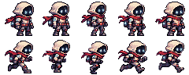

# Game Feel Lab — Godot 4

Uma sala de testes para sentir a diferença que os efeitos de *game feel* fazem em um metroidvania 2D. O viajante agora usa uma spritesheet PNG transparente gerada com apoio de IA. O boneco de treino ainda é desenhado em pixels por código; os sons continuam sintetizados. Não há dependências de plug-ins.

## Como rodar

1. Extraia o ZIP.
2. Abra o **Godot 4.x**, escolha **Importar** e selecione o arquivo `project.godot` da pasta extraída.
3. Aperte **F6** (na cena `main.tscn`) ou **F5** (executar projeto).
4. Aproxime-se do boneco à direita e ataque, alternando os efeitos.

## Controles

| Tecla | Ação |
|---|---|
| `A`, `D` ou setas | Andar |
| `Espaço` ou `W` | Pular |
| `J`, `K` ou clique esquerdo | Atacar |
| `1` | Ligar/desligar white flash |
| `2` | Ligar/desligar squash & stretch |
| `3` | Ligar/desligar hitstop |
| `4` | Ligar/desligar camera shake |
| `5` | Ligar/desligar partículas |
| `6` | Ligar/desligar efeitos sonoros |
| `R` | Reiniciar posição e contagem |

### Compare com e sem efeitos

- Desligue tudo (teclas `1` até `6`), acerte o boneco e observe como o golpe fica seco.
- Ative `1` (flash), depois `3` (hitstop), depois `4` (câmera). Teste cada opção individualmente antes de combinar.
- Ative `2` e pule: a *colisão não muda*, apenas o desenho do personagem se deforma. Compare ao aterrissar.
- Por fim, ative `5` e `6` e veja a contribuição das partículas e do som.

## Arquivos

- `main.tscn`: sala inicial.
- `main.gd`: controle, efeitos, cenário, personagem, dummy e UI.
- `audio/*.wav`: sons originais simples do laboratório.

## Experimentos sugeridos no `main.gd`

| Constante / valor | Experimente |
|---|---|
| `JUMP_SPEED := -302.0` | -260 (pulo baixo), -340 (alto) |
| `MOVE_SPEED := 145.0` | 110 (pesado), 180 (ágil) |
| `shake_strength := 2.9` | 1.0 (sutil), 6.0 (forte) |
| `Engine.time_scale = 0.1` | 0.05 (quase pausa), 0.35 (menos pausa) |
| `create_timer(0.055, ...)` | 0.025 (sutil), 0.09 (marcado) |
| `apply_squash(Vector2(1.27, 0.73), 0.28)` | 1.1 / 0.9 (sutil) |

**Nota:** o laboratório mantém um cenário procedural e um boneco de treino simples, enquanto o viajante já usa arte em imagem real. Ainda estamos testando e refinando os frames, sem tratar a arte como final.

Este protótipo foi escrito para Godot 4 e não depende de recursos pagos.

## Floresta alienígena — experimento visual

O laboratório agora representa a superfície de um planeta coberto por flora bioluminescente, árvores gigantes e insetos voadores. Ao fundo há um planeta com anéis e uma lua. O cenário é desenhado no `_draw()` de `main.gd`; as camadas estão organizadas para futuramente serem extraídas para um `Parallax2D`.

### Viajante interplanetário

O protagonista usa traje claro, visor luminoso, mochila e antena. As animações são geradas proceduralmente por `draw_traveler_frame()`, sem sprites externos:

| Animação | Frames | Ritmo |
|---|---:|---:|
| Idle | 4 | 4 fps |
| Walk | 6 | 10 fps |

Cada frame é uma imagem transparente **32×40 px** com centro horizontal fixo (`x=16`) e base dos pés em `y=38` (com pequena variação vertical intencional no ciclo). O sistema troca frames sem ajustar a posição do nó ou o collider. O filtro de textura mantém os pixels nítidos.

**Nota de qualidade:** esta é uma implementação procedural de referência, não uma spritesheet artística final. O próximo passo é substituir os frames por pixel art desenhada, mantendo dimensões, pivô e silhueta consistentes.

### Teste sugerido

1. Execute F5.
2. Fique parado e observe o idle.
3. Ande com A/D para alternar para a caminhada.
4. Pule e ataque; os efeitos originais do laboratório continuam disponíveis.
5. Compare o alinhamento visual dos pés enquanto o personagem se move.

A arte de referência conceitual serve como direção de estilo; não foi aplicada como imagem única de fundo, pois isso impediria camadas de parallax e reutilização modular.

## Viajante em spritesheet (nova versão)

- **Arte real:** `assets/traveler_sheet.png` (240×96 px), transparência e grade fixa 5×2.
- **Idle:** 5 frames a 4 fps (primeira linha).
- **Corrida:** 5 frames a 10 fps (segunda linha).
- **Integração:** `AtlasTexture` no `main.gd`; o collider continua separado da escala visual.
- **Teste de qualidade:** `python -m pip install Pillow && python tools/validate_sprites.py`.
- **Contrato e processo:** [`docs/SPRITE_PIPELINE.md`](docs/SPRITE_PIPELINE.md).

O cenário agora utiliza camadas PNG em alta resolução com `Parallax2D`, mantendo os controles e os efeitos de game feel.

> A spritesheet foi conferida por análise de pixels e grid; a renderização na Godot precisa ser verificada no editor após o pull.

## V2 — poses-chave em imagem (novembro/2026)

Substituímos o desenho procedural de `main.gd` por uma spritesheet PNG real, produzida a partir de poses-chave de referência e normalizada para uso no Godot.

- `assets/traveler_sheet_v2.png` — atlas **480×192 px, RGBA**, **5 colunas × 2 linhas**, células de **96×96 px**.
- **Idle**: primeira linha, 5 poses, 4 FPS. Respiração/variação de capuz, cachecol e postura.
- **Corrida**: segunda linha, 5 poses, 10 FPS. Contato, compressão, passagem, impulsão aérea e extensão.
- Pés do idle em **y=86** e corrida em **y=86** exceto a pose aérea (y=79). Alinhamento por centro e referência de chão.
- O Sprite2D mantém o collider separado. Escala e offset são intencionais para não afundar os pés na plataforma.
- O laboratório continua com white flash, hitstop, squash/stretch, partículas, som e câmera.

Valide as dimensões e o pivô com `python tools/check_traveler.py` (instale `pip install -r requirements-art.txt`).

**Limite importante:** o grid e o pivô são verificáveis automaticamente; fluidez, gesto, anatomia e credibilidade da corrida ainda exigem revisão visual na Godot.

## Floresta alienígena — PNG nativo, sem SVG ou JPG

O repositório já inclui **todas as cinco imagens PNG 1672×941** em `assets/scenery/`. Nenhuma imagem foi exportada em 480×270. A Godot redimensiona apenas a exibição do atlas, sem substituir o original.

| Camada | Asset | Velocidade horizontal |
|---|---|---|
| Céu | `sky.png` | 0,08 |
| Planeta, ruínas e montanhas | `distant.png` | 0,23 |
| Árvore e cipós | `midground.png` | 0,55 |
| Plantas luminosas | `flora.png` | 0,82 |
| Plataforma jogável | `ground.png` | 1,00 |

O `Parallax2D` utiliza duas cópias espelhadas da imagem para tornar o encontro entre tiles menos visível. O mapa tem 1440 unidades de largura e a câmera acompanha o viajante. Os backgrounds são filtrados linearmente quando reduzidos para a janela, preservando melhor as nuances da arte; a spritesheet do personagem continua nítida.

**Como rodar:** basta executar `git pull origin main` e abrir `project.godot` na Godot 4.7. Os cinco PNGs estão no GitHub e serão importados automaticamente pelo editor. Não é necessário baixar o ZIP separadamente.

Controles: `A/D` para caminhar, `espaço` para pular, `J` para atacar, `1–6` para alternar efeitos, `7` para comparar parallax ligado/desligado, `H` para ocultar painel e `R` para reiniciar.

**Validação:** arquivos publicados e hashes binários conferidos; dimensões e canais alfa verificados. A renderização e a fluidez ainda precisam ser validadas visualmente na Godot.
